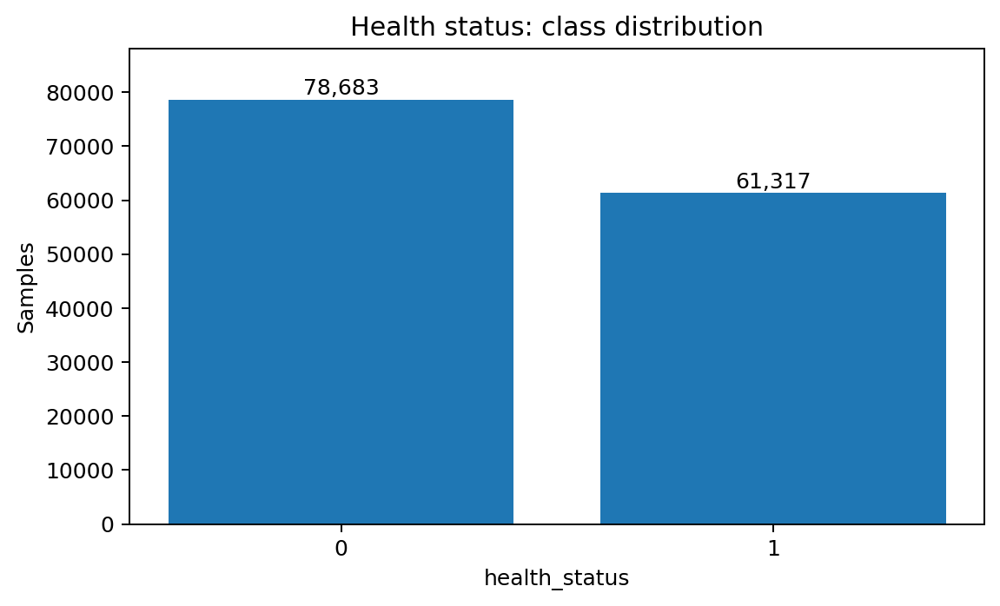
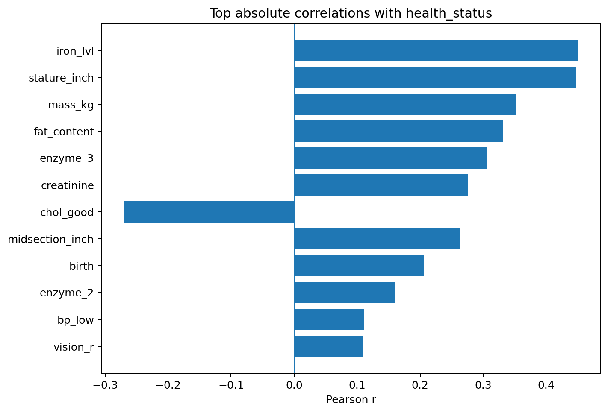
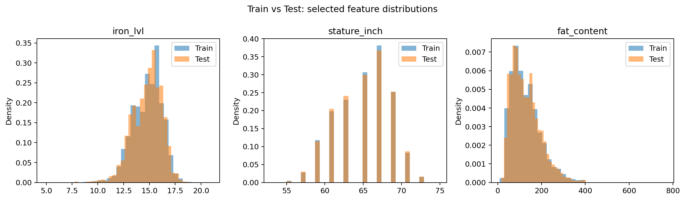

# Health Status Classification | HBNU ADM24 Competition

**2024학년도 2학기 고급데이터마이닝** 수업에서 참여한 Kaggle 건강 상태 이진 분류 프로젝트입니다. 건강정보 기반 정형 데이터의 탐색, 파생 변수 생성, 모델 비교 및 앙상블을 통해 ROC-AUC 성능을 개선하는 데 중점을 두었습니다.

**대회 성과: 3위** (작성자 제공 결과, 순위 캡처 추가 예정)  
**대회:** [HBNU ADM24 Competition](https://www.kaggle.com/competitions/hbnu-adm-24-competition)  
**문제 유형:** Tabular Binary Classification  
**평가 지표:** ROC-AUC

## 1. Problem & Dataset

- 목표: 여러 건강정보로부터 `health_status`(0 또는 1)의 발생 확률 예측
- Train: **140,000 rows × 26 columns** (타깃 포함)
- Test: **19,256 rows × 25 columns**
- 변수: 혈압(`bp_high`, `bp_low`), 콜레스테롤(`chol_good`, `chol_bad`), 철분 수치(`iron_lvl`), 신장/체중, 효소 수치, 시력·청력 정보 등
- 모델 입력에서 식별자 성격의 `index`, `name` 제외
- 학습 데이터 전체에서 결측값 0개 확인. 원본의 `health_status` 클래스 빈도는 아래 EDA 결과 참조.

## 2. EDA (Exploratory Data Analysis)

원 프로젝트에서는 Train/Test 상관관계를 비교하고, 변수별 분포와 건강 상태에 관련된 특성을 탐색했습니다. 아래 그림은 **포트폴리오 정리 시점에 동일 데이터로 다시 생성한 그래프**입니다.

### Target distribution



`health_status=0`: **78,683건(56.2%)**, `1`: **61,317건(43.8%)**.

### Correlation analysis



원 데이터에서 `iron_lvl`, `stature_inch`, `mass_kg`, `fat_content` 등의 변수가 타깃과 상대적으로 높은 양의 상관관계를 보였습니다. 상관관계만으로 원인이나 최종 모델 중요도를 단정하지 않습니다.

### Train vs. Test distribution



## 3. Approach & Experiments

```text
Train/Test CSV
    │
    ▼
EDA & Data Understanding
    │
    ▼
Preprocessing & Feature Engineering
    │       └─ 체격/혈액 성분/효소 간 상호작용 변수 실험
    ▼
Feature Selection
    │       └─ Feature Importance & feature-drop 검증
    ▼
Model Comparison & Hyperparameter Search
    ├─ Logistic Regression / Random Forest 등 비교
    └─ XGBoost / LightGBM / CatBoost (최종 주요 모델)
    ▼
Ensemble Comparison
    ├─ Stacking
    ├─ 규칙 기반 확률 결합
    └─ 가중치 기반 Soft Voting
    ▼
Prediction Probabilities → Kaggle Submission
```

### Feature Engineering & Selection

- 체격 관련 지표, 콜레스테롤·철분·효소 변수 간 파생 특성 생성 및 검토
- LightGBM 기반 Feature Importance 확인과 변수 제거 실험
- 모델별 검증 점수를 비교하며 특성 조합 탐색

※ 일부 기존 파생 변수 계산식은 단위·괄호 검토가 필요하며, 2024년 실험 코드를 임의로 바꾸지 않고 기록했습니다. 자세한 내용은 [실험 노트](docs/EXPERIMENT_NOTES.md)를 참고하세요.

### Model Selection & Tuning

최종 실험에서는 **XGBoost, LightGBM, CatBoost**를 중심으로 Bayesian hyperparameter search를 수행했습니다. 원본 로그에서 확인되는 `BayesSearchCV`는 `scoring='roc_auc'`, **3-fold CV**, 50 iterations 설정입니다.

| Model | Best CV ROC-AUC (logged, rounded) |
|---|---:|
| XGBoost | **0.868** |
| LightGBM | 0.866 |
| CatBoost | 0.866 |

위 수치는 **학습 데이터 내부 교차검증 점수**이며, Kaggle Private/Public Leaderboard 점수가 아닙니다. 파라미터 기록은 [`results/metrics/`](results/metrics/)에 보관했습니다.

### Ensemble

XGBoost, LightGBM, CatBoost 확률을 결합하는 여러 방식을 비교했습니다.

- **최종 제출:** XGBoost : LightGBM : CatBoost = **6 : 2 : 2**
- **추가 제출:** XGBoost : LightGBM : CatBoost = **8 : 1 : 1**
- 비교 대상: Stacking, 규칙 기반 확률 결합, 가중치 기반 Soft Voting

최종 제출 설정은 2024년 발표자료를 근거로 합니다. 현재 보관된 개별 모델 CSV의 가중합과 당시 일부 원본 제출 CSV는 정확하게 일치하지 않으므로, 기록 간 차이는 [실험 노트](docs/EXPERIMENT_NOTES.md)에 별도 기재했습니다.

## 4. Repository Structure

```text
01_Health_Classification/
├── README.md
├── requirements.txt
├── .gitignore
├── data/                       # Data download guide; raw CSV excluded
│   └── README.md
├── notebooks/
│   ├── 01_EDA.ipynb             # 2026 portfolio reconstruction
│   ├── 02_Feature_Engineering_2024.ipynb
│   ├── 03_Logistic_Regression_2024.ipynb
│   ├── 04_Random_Forest_2024.ipynb
│   ├── 05_LightGBM_2024.ipynb
│   ├── 06_XGBoost_2024.ipynb
│   ├── 07_Bayesian_Tuning_and_Ensemble_2024.ipynb
│   ├── 08_Ensemble_Experiments_2024.ipynb
│   └── archive_2024/           # Selected 2024 exploratory notebooks
├── src/
│   └── ensemble.py             # Saved predictions -> weighted ensemble
├── results/
│   ├── figures/                # Regenerated EDA charts
│   ├── metrics/                # Original BayesSearchCV logs & summary
│   └── submissions/            # Historical prediction CSVs
└── docs/
    ├── EXPERIMENT_NOTES.md     # Evidence and caveats
    └── FILE_MAPPING.md         # Original-to-cleanup file map
```

## 5. How to Run

1. Python 환경에 `pip install -r requirements.txt`로 의존성을 설치합니다.
2. [Kaggle 대회 페이지](https://www.kaggle.com/competitions/hbnu-adm-24-competition)에서 `train.csv`, `test.csv`, `sample_submission.csv`를 받아 `data/`에 넣습니다.
3. `jupyter lab`에서 `notebooks/01_EDA.ipynb`를 열면 EDA를 재실행할 수 있습니다.
4. 보관된 모델별 예측 확률 파일로 **8:1:1** 앙상블을 다시 계산하려면 다음 명령을 사용합니다.

```bash
python src/ensemble.py --weights 8,1,1 --output results/submissions/reproduced_8_1_1.csv
```

> **Reproducibility:** 2024년 원본 모델 노트북의 코드는 보존했지만, 중복 셀과 실행 순서의 영향 때문에 모두 즉시 실행 가능한 형태로 리팩터링하지는 않았습니다. EDA와 별도 가중합 스크립트는 독립적으로 재현할 수 있도록 정리했습니다.

## 6. Technologies

`Python` · `pandas` · `NumPy` · `scikit-learn` · `XGBoost` · `LightGBM` · `CatBoost` · `scikit-optimize` · `Matplotlib` · `Seaborn` · `Jupyter Notebook`

## 7. Lessons & Next Steps

- 단일 모델 성능뿐 아니라 파생 변수 설계, Feature Selection, 모델별 검증 점수, 앙상블 방식 선택까지 실험했습니다.
- 교차검증 성능과 리더보드 성능은 구분해서 해석해야 합니다.
- 재현성 향상을 위한 다음 과제: 파생 변수 정의 검증, 계층화 검증, 실험 환경 고정, 최종 제출과 연결된 모델/파일 버전 관리.

*본 저장소는 2024년 대회 자료를 2026년 취업용 포트폴리오 형식으로 정리한 것입니다. 새로 만든 재분석 자료와 원본 실험 코드를 구분해 표시했습니다.*
